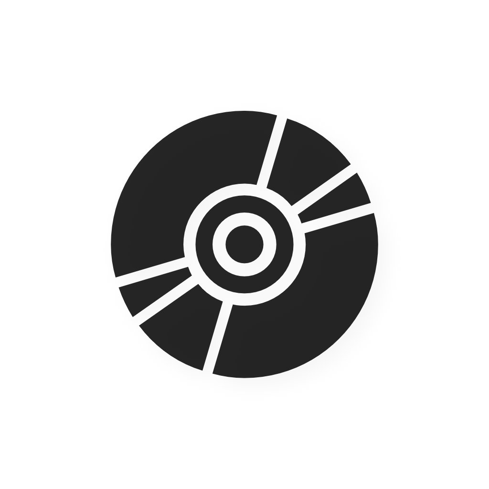
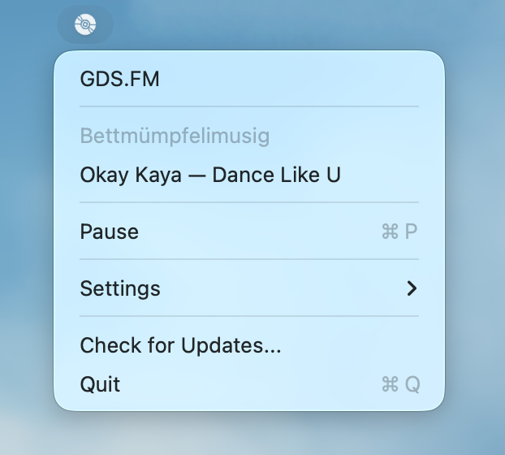

<p align="center">
  
</p>

<h1 align="center">GDS.FM</h1>

<p align="center">
  A macOS menubar app for streaming <a href="https://gds.fm">GDS.FM</a> radio.
</p>

<p align="center">
  ✨<a href="https://github.com/jorisnoo/GDSPlayer/releases/latest">Download</a>✨
</p>

<p align="center">
  
</p>

---

## Install

```sh
brew install jorisnoo/tap/gds-fm
```

Or download the latest DMG from [Releases](https://github.com/jorisnoo/GDSPlayer/releases/latest).

## Requirements

- macOS 15+ (Catalina)
- Xcode 16+

## Build

1. Open `GDSPlayer.xcodeproj` in Xcode
2. Build and run (⌘R)

For releases, signed builds and notarisation, see [RELEASING.md](RELEASING.md).

## License

MIT
